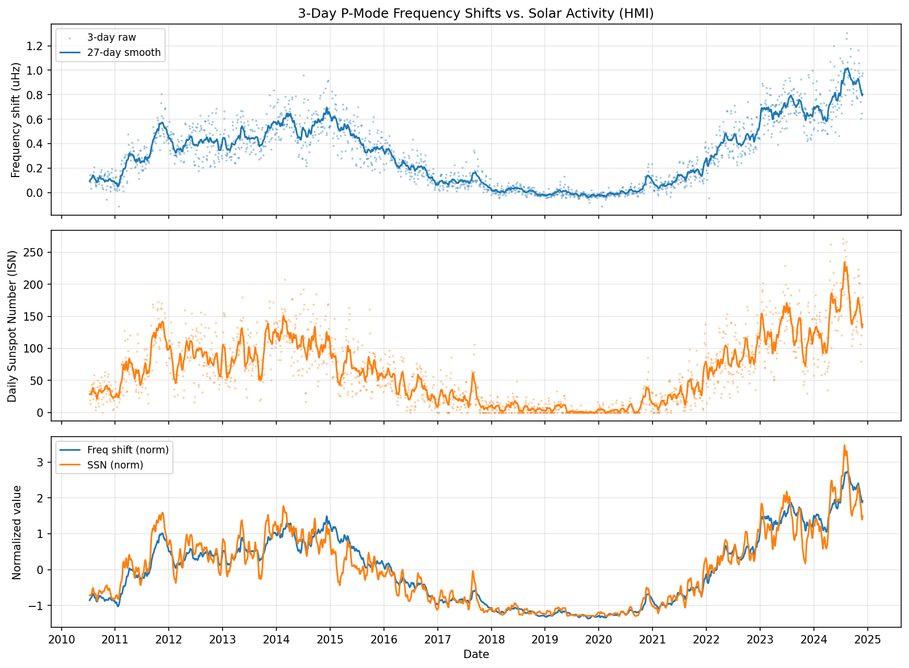
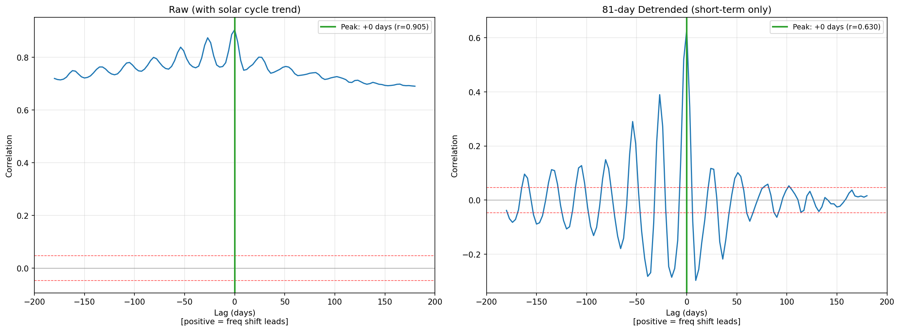

# Solar P-Mode Frequency Shifts: Lead-Lag Analysis with 3-Day Resolution

**Helioseismic frequency shifts vs. solar surface activity -- do p-mode oscillations lead sunspot variations?**

## Key Results

| Analysis | Peak Lag | Correlation | Conclusion |
|----------|----------|-------------|------------|
| Raw (with trend) | 0 days | r = 0.905 | Synchronous |
| 81-day detrended | 0 days | r = 0.630 | Synchronous |
| 365-day detrended | 0 days | r = 0.659 | Synchronous |
| F10.7 detrended | 0 days | r = 0.588 | Synchronous |

**Finding:** P-mode frequency shifts and solar surface activity (sunspot number, F10.7 flux) vary **synchronously** at 3-day resolution, with no detectable lead or lag. Adding helioseismic features to an XGBoost forecasting model provides no improvement over SSN autoregression alone, confirming the information is redundant.




## Background

Solar p-mode oscillation frequencies shift by ~0.3-1.3 uHz over the solar cycle, tracking magnetic activity. Some studies have suggested these shifts could *lead* surface activity indicators by days to weeks, potentially serving as a precursor signal from subsurface magnetic field changes.

This project tests that hypothesis using:
- **1,752 three-day frequency shift measurements** from SDO/HMI (2010-2024)
- **~3,600 p-mode (n, l) modes** per measurement, inverse-variance weighted
- Cross-correlation analysis with detrending at multiple timescales
- XGBoost prediction comparison (autoregressive baseline vs. helioseismic-enhanced)

## Data Pipeline

### Frequency Shift Extraction (`extract_3day_freqshift.py`)

Runs on USC Discovery HPC. Extracts mean frequency shifts from the Rhodes group's fitted p-mode ratios files:

1. Scans 1,831 `weightedhmi*` directories, filters to 1,752 three-day dateranges
2. Parses `.ratios` files: columns are l, n, amplitude, amp_err, **freq (uHz)**, **freq_err (uHz)**, ...
3. Selects reliable modes: 1500 < nu < 3500 uHz, sigma_nu < 10 uHz
4. Finds common modes present in >=90% of epochs: 3,608 modes
5. Builds reference from SC24 solar minimum (MDI day 9352-9712, ~2018-2019)
6. Computes dnu(n,l,t) = nu(n,l,t) - nu_ref(n,l) per mode, then inverse-variance weighted mean

### Solar Activity Data

- **ISN**: Daily International Sunspot Number from [SILSO/WDC](https://www.sidc.be/SILSO/datafiles) (downloaded automatically)
- **F10.7**: Penticton 10.7 cm radio flux from [LISIRD/LASP](https://lasp.colorado.edu/lisird/) (downloaded automatically)

## Analysis

### Lead-Lag Cross-Correlation (`leadlag_analysis_v2.py`)

- Raw cross-correlation dominated by shared ~11-year solar cycle trend (r = 0.905 at all lags)
- After removing 81-day running mean: sharp peak at lag = 0 (r = 0.630), with ~27-day oscillation from solar rotation
- Block bootstrap (2000 iterations): 95% CI for peak lag = [0, 0] days at all detrending cutoffs
- Consistent across SSN and F10.7

### ML Prediction (`xgboost_prediction.py`)

| Horizon | RMSE (SSN only) | RMSE (+ Helio) | Change |
|---------|----------------|----------------|--------|
| 3 days  | 24.35 | 25.67 | +5.4% worse |
| 9 days  | 39.73 | 44.70 | +12.5% worse |
| 27 days | 39.62 | 44.37 | +12.0% worse |
| 81 days | 44.34 | 49.42 | +11.5% worse |

Adding frequency shift features consistently *worsens* predictions due to collinearity-driven overfitting.

## Physical Interpretation

P-mode frequency shifts and sunspot numbers are both **simultaneous responses** to near-surface magnetic field changes. Neither leads the other because they are driven by the same physical process (magnetic pressure perturbations) operating on the same timescale. The ~27-day modulation in the detrended cross-correlation reflects solar rotation carrying active regions in and out of view.

This null result places an upper bound of **< 3 days** on any lead/lag between helioseismic frequency shifts and surface activity indicators, using the highest-cadence (3-day) dataset spanning a full solar cycle (SC24-25).

## Repository Structure

```
solar-frequency-shifts/
├── README.md
├── requirements.txt
├── .gitignore
├── 3day_freq_shifts.csv              # Extracted frequency shifts (1,752 epochs)
├── leadlag_analysis.py               # v1 lead-lag analysis
├── leadlag_analysis_v2.py            # v2 with detrending (main)
├── xgboost_prediction.py             # ML prediction comparison
├── results/                          # v1 analysis outputs
│   ├── fig1_timeseries_ssn.png
│   ├── fig2_xcorr_ssn_*.png
│   ├── fig3_bootstrap_*.png
│   └── fig4_scatter_*.png
├── results_v2/                       # v2 analysis outputs (detrended)
│   ├── fig1_timeseries.png
│   ├── fig2_detrend_*.png
│   ├── fig3_xcorr_comparison.png
│   ├── xcorr_*.png
│   └── leadlag_summary.csv
└── results_ml/                       # XGBoost outputs
    ├── pred_h*d.png
    ├── importance_h*d.png
    ├── fig_horizon_comparison.png
    └── ml_results.csv
```

## Usage

### Extract frequency shifts (USC Discovery HPC)

```bash
# Inside Singularity container
python3 extract_3day_freqshift.py \
    --base /home/rcf-04/astro10/wmltp/theor1.0 \
    --output 3day_freq_shifts.csv
```

### Run analysis (local)

```bash
pip install -r requirements.txt

# Lead-lag analysis with detrending
python3 leadlag_analysis_v2.py --freq-csv 3day_freq_shifts.csv --output-dir results_v2

# XGBoost prediction
python3 xgboost_prediction.py --freq-csv 3day_freq_shifts.csv --output-dir results_ml
```

## Data Source

Frequency shifts derived from SDO/HMI spherical harmonic power spectra processed by the USC Solar Physics Group (Prof. Edward Rhodes, PI). Raw spectra from [Stanford JSOC](http://jsoc.stanford.edu/).

## Author

Dongpo Bai -- University of Southern California, Department of Physics & Astronomy
